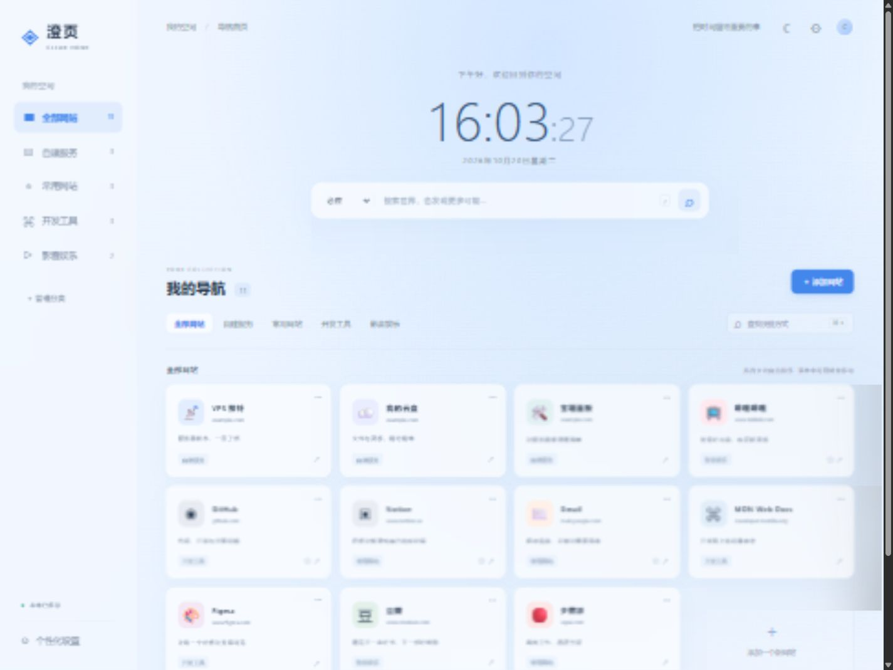

# 澄页 · Clear Home

清爽蓝色玻璃拟态的个人导航首页。原生 HTML / CSS / JavaScript + PHP，网站数据保存到 VPS，手机和其他浏览器共享同一份导航。



## 功能

- 中文界面、响应式卡片、实时数字时钟与日期。
- 网站添加、编辑、删除；名称、URL、Emoji、描述和打开方式均可设置。
- 分组分类、拖拽排序、键盘/手机菜单排序、常用收藏和关键词过滤。
- 必应、百度、Google、哔哩哔哩搜索引擎切换。
- 深浅色主题、跟随系统、自定义强调色和背景图片。
- 管理员登录后自动保存到 VPS；未登录可查看、打开和搜索。
- JSON 导入导出、旧版本机数据迁移、多设备版本冲突保护。
- 写入失败明确提示，未保存内容可导出；文件锁与原子替换保护导航文件。

## 部署选择

| 使用场景 | 入口 |
| --- | --- |
| 宝塔 / aaPanel 类面板 | [宝塔部署说明](docs/deploy-baota.md) |
| Debian / Ubuntu + Nginx + PHP-FPM | [普通 Linux VPS 部署](docs/deploy-linux.md) |
| 换 VPS、恢复书签、升级回退 | [备份与迁移](docs/backup-migration.md) |
| 空白接口、目录限制、保存失败 | [排障手册](docs/troubleshooting.md) |

**运行要求：PHP 8.2+、Nginx 或等效 PHP Web 服务、有效 HTTPS。无需数据库、Composer、npm 依赖或 Node.js 守护进程。** GitHub Pages 只能托管静态前端，不能运行本项目的跨设备保存接口。

## 快速准备（宝塔示例）

```sh
git clone https://github.com/czy-code-923/clear-home.git /opt/clear-home-source
/www/server/php/82/bin/php /opt/clear-home-source/scripts/prepare.php /www/wwwroot/clear-home
```

准备后，网站根目录设为 `/www/wwwroot/clear-home/public`，真实配置与数据放在它外面。复制同级模板为 clear-home-config.php，设置至少 12 位的管理员密码、PHP 用户权限、open_basedir、FastCGI 和 HTTPS，按[完整宝塔说明](docs/deploy-baota.md)操作。

**准备工具只复制 5 个运行文件和无密码模板，不修改已有真实配置和数据。** 新 VPS 不需要复制整个开发目录到公开根目录。

## 配置

部署工具生成的模板：

```php
<?php
return [
    'admin_password' => 'CHANGE_THIS_PASSWORD',
    'data_dir' => __DIR__ . '/clear-home-data',
    'secure_cookie' => false,
];
```

将密码占位文字替换为自己的独立密码（推荐 16 位以上），生产 HTTPS 站点把 secure_cookie 设为 true。配置不能放进公开目录或提交到 GitHub。默认依次查找：CLEAR_HOME_CONFIG 环境/同名 FastCGI 参数 → 网站根目录上一层 clear-home-config.php → 旧宝塔两层上级配置。原有 `/www/clear-home-config.php` 布局继续兼容。

## 首次使用与旧版迁移

1. 打开 HTTPS 首页，点击右上角「管理员登录」。
2. 添加或编辑网站，等待「已保存到 VPS」。首次示例需要管理员第一次保存后才写入服务器。
3. 用另一个浏览器或手机打开相同站点即可查看；无需再次导入。
4. 旧版网站若只存在原浏览器本地，先导出 JSON，再在新版设置中「导入备份」或「发布旧版本机导航」。

所有访问者读取同一份**公开导航**，只有管理员可修改。它是个人共享首页，不是每位访问者独立账号的私有书签服务。导航 URL 中不要携带密码或访问令牌。

已打开的其他页面约 20 秒同步一次，切回页面也会刷新；编辑弹窗打开时暂缓刷新。离线时不会伪装成服务器保存成功。

## 日常操作

卡片右上角 `···` 管理网站，桌面拖拽或菜单排序，编辑所属分类可跨分类移动。设置中管理分类、备份和外观。

- `/`：聚焦互联网搜索。
- `Ctrl/Cmd + K`：查找快捷方式。
- `Esc`：关闭弹窗或退出筛选。

VPS 探针、云盘、面板使用 example.com 占位地址，请替换。背景支持不超过 2 MB 的 JPG/PNG/WebP。

## 本机预览与测试

直接双击 index.html 是明确标注的本机模式，不跨设备同步。完整本机预览需要 PHP 8.2+，将 CLEAR_HOME_CONFIG 设置为公开根目录之外的真实配置路径，再执行：

```sh
php -S 127.0.0.1:4173 -t .
```

PHP 内置服务仅用于本机。生产环境按 VPS 文档配置 Nginx + PHP-FPM，不公开内置开发服务。

开发检查额外需要 Node.js 22+（无需安装第三方 npm 包）：

```sh
npm run check
npm test
```

PHP 不在 PATH 时，测试可设置 PHP_BINARY 为可执行文件绝对路径。CI 自动检查 PHP 8.2 / 8.3 / 8.4。测试覆盖独立会话同步、重启持久化、登录与 CSRF、版本冲突、数据验证、部署产物和配置隔离。

## 源码结构

```text
index.html / style.css / app.js / sync.js   前端
api.php                                    PHP 保存与登录接口
clear-home-config.example.php              无密码模板
scripts/prepare.php                        生成可部署的 public 目录
deploy/                                    Nginx 与 open_basedir 示例
docs/                                      安装、迁移、更新与排障
tests/                                     独立临时数据集成测试
.github/workflows/test.yml                 自动检查
```

仓库不包含真实服务器配置、书签数据、密码、证书或登录会话；.gitignore 已排除这些内容。源码克隆后仍需按文档初始化，个人导航通过私有备份迁移。
